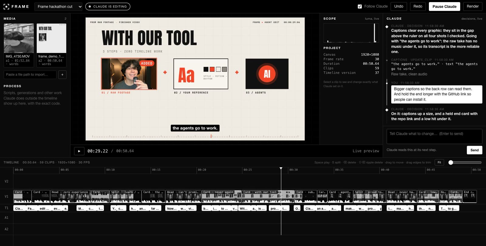

# Frame

**The live editing room for Claude.**

When Claude edits a video today, you stare at a spinner and get a file at the end. Frame opens a window the moment editing starts and shows the whole thing happening: footage landing in the bin, Claude's reasoning, every cut, caption and effect appearing on a real timeline. You can stop it, tell it to change course, or grab a clip and fix it yourself. Claude sees what you did and carries on from there.

Frame is an MCP server. It does not add a new AI or a new kind of video; it gives Claude's editing a visible, editable footprint.



**48-second demo:** [demo/frame-hackathon-demo.mp4](demo/frame-hackathon-demo.mp4)

**Working on Frame, or pointing an AI at it?** Start with [AGENTS.md](AGENTS.md): how to run, test, read and change it, with the design reasoning in [docs/](docs).

## What you get

- **A window that opens by itself** when Claude starts an edit.
- **A live feed of decisions** — plan, thinking, each operation with the reason for it.
- **A real timeline** — video, text and audio tracks, thumbnails, waveforms. Clips appear as Claude places them.
- **Real-time preview** of the timeline in the browser, and a player for the rendered file.
- **Your hands on the same timeline** — drag to move, drag edges to trim, split, delete, change any property in the inspector, undo. Claude is told exactly what you changed.
- **Steering** — type a message in the window, or press Pause. Claude receives it at its next step.
- **Nothing hidden** — work Claude does outside the timeline (a script, an ffmpeg command, an AI generation) is logged in a Process panel with the exact code.
- **Measured, not guessed** — loudness, silences, durations and render results come from ffmpeg and are reported as numbers.
- **Black and white.**

## Requirements

- Node.js 18 or newer
- ffmpeg and ffprobe on your PATH (macOS: `brew install ffmpeg` · Windows: `winget install Gyan.FFmpeg`)
- Optional, for transcripts and automatic captions: Whisper (`pip install -U openai-whisper`)

No npm dependencies. No account. No API key. Everything runs on your machine and binds to `127.0.0.1` only.

## Install

### Claude Code

```bash
git clone https://github.com/dantegarcia654/frame-mcp.git && node frame-mcp/bin/frame.js install
```

On Windows PowerShell 5.1 (the one built into Windows), `&&` is not allowed, so run the two halves one after the other:

```powershell
git clone https://github.com/dantegarcia654/frame-mcp.git
node frame-mcp/bin/frame.js install
```

That registers Frame for your user. Open a new Claude Code session and say:

> Edit this video with Frame: /path/to/clip.mp4 — cut the dead air, add captions, render it.

### Any other MCP client (Claude Desktop, Cursor, …)

```json
{
  "mcpServers": {
    "frame": { "command": "node", "args": ["/absolute/path/to/frame-mcp/bin/frame.js", "mcp"] }
  }
}
```

Check your setup any time with `node bin/frame.js doctor`.

## How it works

```
Claude ──MCP (stdio)──▶ frame mcp ──HTTP──▶ Frame service (127.0.0.1:4747) ──SSE──▶ the Frame window
                                                  │
                                                  └── ffmpeg / ffprobe / whisper
```

The service owns the project. Claude's tool calls and your mouse both go through the same operation engine, so there is exactly one timeline. The final MP4 and the still frames Claude checks are produced by one ffmpeg filter graph built from that timeline. Text is drawn by the window and handed to ffmpeg as images, so what you preview is what gets rendered.

Projects live in `~/.frame`. Renders go to `~/Movies/Frame` (`~/Videos/Frame` on Windows) unless Claude is told otherwise. Your source files are only ever read.

## Tools

| Tool | What it does |
| --- | --- |
| `frame_start` | Opens the window and a project. Always the first call. |
| `frame_import` | Adds video, audio or images; measures loudness and silences. |
| `frame_transcribe` | Word-level transcript (local Whisper), or accepts supplied words. |
| `frame_note` | Shows Claude's thinking and decisions in the feed. |
| `frame_edit` | Timeline operations, applied live: add, keep ranges, trim, split, move, delete, cut range, remove silences, text, captions, grade, chroma key, scale/position, speed, volume, fades. |
| `frame_step` | Logs work done outside Frame with its exact code and imports the outputs. |
| `frame_view` | Returns composited frames (or raw source frames) so Claude can look at its work. |
| `frame_state` | Re-reads the timeline and collects your changes and messages. |
| `frame_wait` | Waits for you when Claude asked a question or was paused. |
| `frame_history` | Undo / redo. |
| `frame_render` | Renders H.264/AAC MP4 through ffmpeg; reports measured size, duration and loudness. |

## Honest limits (v1.0)

- Effects are the ones listed above. No keyframed animation, no motion tracking, no transitions beyond fades, no generative effects built in. Claude can still do those elsewhere and bring the result in through `frame_step`.
- The live preview approximates chroma key and plays volume above 100% at 100%; rendered frames and the export are exact.
- Text needs the Frame window open at render time, because the window draws it.
- Your message reaches Claude at its next tool call, not mid-thought. Pause stops further edits; it cannot interrupt a render already running.
- One project is on screen at a time.
- Tested on macOS and Windows 11 (Whisper transcripts not yet on Windows). Linux should work.

## Command line

```
frame mcp        MCP server over stdio (what your client launches)
frame install    register with Claude Code
frame open       open the window
frame doctor     check ffmpeg / whisper / service
frame call <tool> '<json>'   call any tool from a shell
frame stop       stop the local service
```

`scripts/record.mjs` records the window to an MP4 using the Chrome already installed; `--script demo/shots.mjs` drives the page with a scripted mouse while it records. That is how the demo was made.

Environment: `FRAME_PORT` (default 4747), `FRAME_HOME` (default `~/.frame`), `FRAME_PACE` (ms between visible operations, default 140), `FRAME_NO_OPEN=1` (do not open a browser).

## License

MIT
