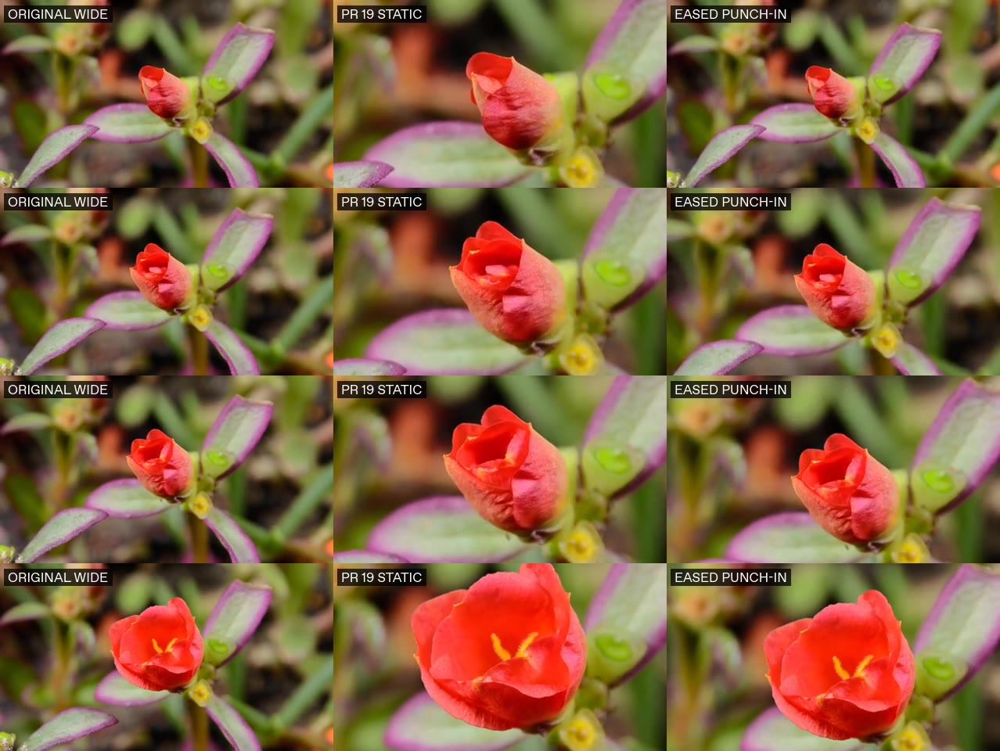

# A live punch-in timed to the bloom

The shot holds wide until 1.55 seconds, eases into the opening flower over 0.70 seconds, then holds the closer composition. The curve is saved on the footage clip. During playback FRAME evaluates it at the existing playhead, so applying the request during the ramp immediately shows the position on the new curve. Replaying from the start shows the whole ramp.

- [Wide source, PR #19 static crop, and eased punch-in side by side](../.github/evidence/live-punch-in/three-way.mp4)
- [Landscape timeline from live request to export](../.github/evidence/live-punch-in/wide-live-to-export.mp4) and [landscape export](../.github/evidence/live-punch-in/landscape-export.mp4)
- [Portrait timeline from live request to export](../.github/evidence/live-punch-in/portrait-live-to-export.mp4) and [1080×1920 portrait export](../.github/evidence/live-punch-in/portrait-export.mp4)
- [Landscape measurements](../.github/evidence/live-punch-in/wide-measurements.json), [landscape tool transcript](../.github/evidence/live-punch-in/wide-mcp.jsonl), [portrait measurements](../.github/evidence/live-punch-in/portrait-measurements.json), and [portrait tool transcript](../.github/evidence/live-punch-in/portrait-mcp.jsonl)



## Visual assessment

The wide composition introduces the stem and surrounding leaves. At 1.9 seconds the eased shot is already closer while retaining the bud's surroundings. At 2.23 seconds the petal opening carries the frame. At 4 seconds it leaves more room above the bloom than PR #19's 1.85× crop. The camera move feels motivated by the subject opening and the score accent at 2.1 seconds. In portrait, the separate text layer stays put and the petals fill the central panel. The portrait crop loses some outer petals and magnifies the softness in the 960×540 source.

**Verdict · effective timed reveal, human review pending.** The experiment adds a distinct camera beat to one shot. The results have limited scope for a multi-shot creator edit. The comparison uses the same footage and score for every version, with PR #19's static zoom and focus settings reproduced. The footage is MDN's CC0 flower fixture, and the source is silent and the test score was synthesized. [Pinned CC0 media](https://github.com/mdn/interactive-examples/blob/13024db581b08fae11a0ca229497198b9b0534e7/live-examples/media/cc0-videos/flower.mp4)

## What passed

The evidence was captured on implementation commit `6d5da11089a85f76dccc56a9b86d78110198cb13` using Chromium 154, Node 24.19, and FFmpeg 7.1.5. Landscape and portrait were run sequentially in clean FRAME homes.

| Check | Landscape | 1080×1920 with live text |
| --- | ---: | ---: |
| Local MCP request to first changed Canvas draw with at least 2% magnification | 15 ms | 20 ms |
| Largest gap between changing picture samples | 52 ms | 75 ms |
| Largest gap between decoded-frame callbacks | 58 ms | 59 ms |
| Skipped frame callbacks / pause, seek, wait, stall, or reload events | 0 / 0 | 0 / 0 |
| Minimum sampled browser audio RMS | 0.0336 | 0.0336 |
| Preview/export SSIM across nine timecodes | 0.951–0.972 | 0.972–0.982 |
| Final 150-frame export request to completion | 2.03 s | 7.97 s |
| Full scripted check, including control exports | 19.67 s | 30.47 s |

The same project ID and media element advanced over roughly 0.7–4.2 seconds of timeline time. The request landed at about 1.8 seconds, where the ramp's evaluated transform differed from the wide pose. The browser audio recording had zero silence intervals below −43 dBFS lasting 45 ms or longer. Both five-second exports decoded in full. Decoded audio hashes matched their respective controls, including the wide and static landscape renders.

The parity checks use corresponding frames before, during, and after the ramp at 0.80, 1.70, 1.867, 1.90, 2.00, 2.133, 2.267, 2.60, and 4.00 seconds. Portrait exports are resized to match the Canvas preview before comparison. The portrait footage region alone, excluding the typography bands, scored 0.965–0.979. Both runs rejected reversed keyframes without changing the clip, then accepted the valid request and recovered the same saved curve after reopening the project. The smoke test separately exercises protection and explicit replacement of prior position keyframes, restoration through Review, and preserving curve phase on split.

`node test/live-update.js` passed. The full smoke suite passed 66 checks and reproduced the two PR #19 headless caption failures. An independent render check with a nonzero clip start and source in-point measured 0.988 SSIM for an export window and 0.959 for a still against the full render at the same timecode.

An earlier concurrent portrait trial missed the picture probe threshold. The final standalone runs passed. The worst gaps above include the recorder and pixel-sampling overhead. A busy-device or 4K performance envelope remains unmeasured.

The screen recordings are continuous excerpts. The live tool arrives around 2 seconds into each recording. Actual media-element audio is captured through Web Audio and muxed at the matching screen clock mark. The capture covers the live timeline section. The standalone exports carry their actual export audio. [Landscape screen marks](../.github/evidence/live-punch-in/wide-marks.json) · [Portrait screen marks](../.github/evidence/live-punch-in/portrait-marks.json)

These were direct local MCP calls. Claude Code was absent from the environment and authenticated model invocation was unavailable. The tool transcripts are protocol transcripts. Human visual acceptance, physical filming conditions, and acoustic speaker capture remain pending.

## Editing contract and tradeoffs

`frame_reframe` accepts two to eight camera poses, each with `t`, `zoom`, and `x`/`y` source fractions. `t` is measured in clip-relative timeline seconds. Zoom is relative to cover. Easing applies into each pose and defaults to cubic ease-in-out. Poses hold outside the keyed range. The virtual camera is clamped to source edges on every frame.

Existing position keyframes are protected. Supply `replace_motion:true` to replace them or to turn a keyed crop back into a static crop. Sending a new keyframe list explicitly replaces the previous crop curve. Review can restore a replaced curve or the original position animation. Clearing an animated crop from the inspector exposes the prior static placement. A split carries the curve phase into the right piece. Trims and speed changes keep timings relative to the clip's resulting start.

The existing clip delta publishes the new state after the revision is saved. Canvas evaluates the crop on the current decoded frame. FFmpeg independently evaluates the same easing and geometry, scales the input per frame, and crops it to fixed project dimensions before layering. This keeps the shared edit, audio, and final export paths in use and avoids an intermediate file or a media handoff. FFmpeg receives explicit animated crop dimensions because the crop filter's input-size variables do not follow per-frame scaling.

Scaling the whole source can be expensive for highly mismatched aspect ratios or 3× zoom. The vertical export was about eight seconds for five seconds of footage with live graphics. The quality and speed of direct source-window sampling at higher resolutions is a useful next comparison. Tracked matte composites and transformed clean plates have no filmed parity result in this experiment.

## Reproduce

Use Node 22.4+, Chromium, FFmpeg, and a fresh FRAME home for each run. Run the portrait and landscape checks one at a time.

```sh
fixture="$(mktemp -d)"
export FRAME_PUNCH_SOURCE="$fixture/flower.mp4"
curl -fL -o "$FRAME_PUNCH_SOURCE" \
  https://raw.githubusercontent.com/mdn/interactive-examples/13024db581b08fae11a0ca229497198b9b0534e7/live-examples/media/cc0-videos/flower.mp4
export FRAME_NO_OPEN=1 FRAME_DECISIONS=off
for variant in wide portrait; do
  export FRAME_HOME
  FRAME_HOME="$(mktemp -d)"
  export FRAME_PORT=4874 FRAME_PUNCH_PORTRAIT=0
  if [ "$variant" = portrait ]; then export FRAME_PUNCH_PORTRAIT=1; fi
  node bin/frame.js call frame_start '{"name":"Benchmark"}'
  node scripts/record.mjs "$fixture/$variant.mp4" --size 1440x900 --script scripts/check-live-punch-in.mjs
  node bin/frame.js stop
done
```

The runner saves the uncut screen recording, browser audio, clock marks, preview and export frames, MCP requests and replies, metrics, and rendered MP4s. To add browser audio to the recording, use the matching mark with FFmpeg.

```sh
record="$fixture/portrait.mp4"
ffmpeg -i "$record" -itsoffset "$(jq -r '.marks.browserAudioStarted' "$record.marks.json")" \
  -i "$record.evidence/browser-audio.webm" -map 0:v -map 1:a -c:v copy -c:a aac "$fixture/portrait-audible.mp4"
```

The three comparison clips are in `"$fixture/wide.mp4.evidence"`. Stack the wide, static and animated exports from left to right for a synchronized comparison.

```sh
wide="$fixture/wide.mp4.evidence"
ffmpeg -i "$wide/Bloom-study-punch-in_v3.mp4" \
  -i "$wide/Bloom-study-punch-in_v2.mp4" -i "$wide/Bloom-study-punch-in_v1.mp4" \
  -filter_complex '[0:v]scale=426:240[a];[1:v]scale=426:240[b];[2:v]scale=426:240[c];[a][b][c]hstack=inputs=3[v]' \
  -map '[v]' -map 2:a -c:v libx264 -pix_fmt yuv420p -c:a copy "$fixture/comparison.mp4"
```

To make the edit on a playing landscape clip, use the active project and clip IDs from `frame_state`.

```json
{
  "project_id": "p_…",
  "clip_id": "c_…",
  "keyframes": [
    {"t": 1.55, "zoom": 1, "x": 0.5, "y": 0.5},
    {"t": 2.25, "zoom": 1.6, "x": 0.458, "y": 0.405, "e": "io"}
  ]
}
```
