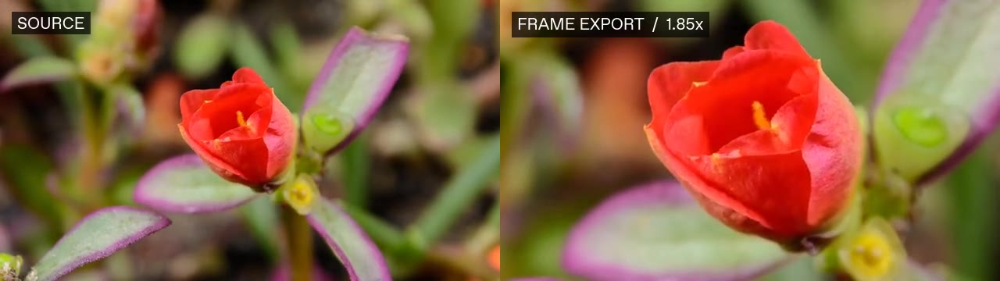

# Reframe footage during playback

`frame_reframe` takes an exact clip ID, a zoom relative to cover, and a point in source coordinates. It changes the composition on the next preview draw and saves the crop to the existing timeline. The shot above and below the playhead uses the edited crop on replay and export. Use Review to restore its previous framing.

## The shot



- [Source and export played side by side](../.github/evidence/live-reframe/source-vs-export.mp4) and [original FRAME export](../.github/evidence/live-reframe/final-export.mp4), both 5 seconds.
- [Uncut FRAME screen capture with browser audio](../.github/evidence/live-reframe/player-with-browser-audio.mp4). Seek to 3.33, 5.92 and 8.50 seconds for the three requests. Displayed timeline time is about 1.2 seconds at each crop. There are intentional resets between runs. The first run includes a rejected request before the successful one.
- [Local MCP transcript](../.github/evidence/live-reframe/mcp.jsonl), [measurements](../.github/evidence/live-reframe/measurements.json), [screen marks](../.github/evidence/live-reframe/screen-marks.json), and [PR #17 scout](../.github/evidence/live-reframe/pr17-scout.json).

The flower imagery is from MDN's CC0 example. The sample's original audio stream is silent. The test adds an original three-note synthesized bed. The screen recording muxes audio captured from the actual playing HTML media element through Web Audio, aligned to the Chrome screen-capture clock by the start mark. The source/export comparison uses the exported audio. The MCP transcript records direct local protocol calls. [CC0 source](https://github.com/mdn/interactive-examples/blob/13024db581b08fae11a0ca229497198b9b0534e7/live-examples/media/cc0-videos/flower.mp4)

**Visual judgment · NOT YET.** At 0–2 seconds, the close-up makes the curled rim of the bud easier to read. At 3 seconds, the orange stamens become the natural focal point instead of competing with the diagonals of the surrounding leaves. Near 4–5 seconds the growing petals crowd the upper boundary, and the crop magnifies the source softness. The editor interaction is a crisp jump, and the final shot has one static composition throughout. The source supplies all motion and pacing. A human review of the full sequence is pending. The exact Justin AI and Katana Pixel reference assets are unconfirmed, so there is no reference comparison or shoot-readiness claim.

## PR #17 baseline and breadth

PR #17 at `3f15abcac324baa60e7a819db37095207e76a48a` delivered a saved live title and a presentation timeline. Its Chromium demo reproduced the title change in 38 ms on synthetic motion footage. The same project and two media elements kept advancing, and decoded audio across the two exports matched. The baseline recorder itself was silent. The test checked element state for playback audio. The focused live-update test passed. [Acceptance benchmark](https://github.com/dantegarcia654/frame-mcp/pull/17#issuecomment-7022426696)

The scout used PR #17, the scored flower footage, and an independently seeded project per operation. Its timings measure submission to observed browser project version, with one observation per row. It polled the playhead and active media elements around the edit. Direct browser/audio-capture measurements and export checks for the focus crop appear in the following section.

| Operation | Result during playback | Latency | Continuity | Export and outcome |
| --- | --- | ---: | --- | --- |
| Scoped title change | Wording and color applied live | 38 ms to visible pixels | Same picture and audio elements advanced | Title pixels and decoded audio checked by the baseline runner |
| Keyframed typography | (BLOOM) moves across the shot after a live animation patch | 7 ms to state | Same media element, zero pause/wait/seek events | Live preview pass. Export parity unmeasured |
| Overlay and grade | Live line overlay and grayscale tried independently | 13 ms each to state | Same media element, zero pause/wait/seek events | Live preview pass. Export parity unmeasured for these runs |
| Tracked/person effects | Existing preview paths use prepared tracking and matte data | Unmeasured | Required prep and multi-stream continuity unverified | Requires analysis when the source lacks a prepared cutout. Exact parity unverified |
| Static footage crop | Existing `update_clip` can already draw the same crop during playback using manually computed placement | 12 ms to state | Same media element, zero pause/wait/seek events | Live preview pass. New crop export checked below |
| Split-screen | Muted second panel appeared alongside the original; loads a second media element | 30 ms to state | Original media element kept advancing | Live preview pass for this small fixture. Second-panel readiness and parity unmeasured |
| Clip timing | Split earlier than current playhead applied | 12 ms to state | Original element paused as the active slot changed | Failed same-decoder continuity. Sub-poll audio gap unknown |
| Timed caption and gain | Manual caption and source gain edit accepted during playback | 26 / 18 ms to state | Same media element, zero pause/wait/seek events | Live preview pass. Automatic transcription and export parity unmeasured |
| Concurrent calls | One grade and one title-color tool call completed | 30 ms to both states | Same media element, zero pause/wait/seek events | Pass for disjoint local calls. Same-field conflicts and multiple model clients unverified |

JSON contains the exact operations and observed events. The scout used the local MCP bridge's underlying caller. It measured state delivery and media element continuity. Pixel latency, silence under the polling interval, and export parity need their own checks.

## Reframe result

Implementation tested at `8ba80a2274a59772e220c482115a4f325f29bd03` with Chromium 154, Node 24 and FFmpeg 7.1.5.

| Operation | Visible result | Live latency | Picture and audio | Export | Result |
| --- | --- | --- | --- | --- | --- |
| 1.85× focus, 1.55× alternate focus, 1.85× repeat | Wide view jumps to a centered detail while petals keep opening | 14, 32, 25 ms from local request to first instrumented crop draw. Median 25 ms | Zero pause, seek, waiting, stall or reload events in the sampled windows. Same media element and project. Largest gap between changing picture samples was 54 ms. All decoded-frame callback counters advanced without skips. Browser audio remained above −30 dBFS RMS in the sampled windows | Five-second 960×540 MP4 decoded successfully. Preview-to-export image SSIM 0.910 at 3 s, versus 0.433 against the uncropped source. Decoded audio MD5 identical to uncropped control | 3/3 applied. Rejected zoom preserved the clip and playback, and the next valid request applied. Saved crop survived project reopen |

The audio record had no interval under −43 dBFS lasting 45 ms or longer. The frame and audio instrumentation sampled about 1.9 seconds around each edit. The duration from export request to completion was 2.05 seconds. The screenshot and frame parity measure one timecode, and the comparison video covers all five seconds. Preview and export use different resampling and frame clocks, so pixel equality is outside this check.

`node test/live-update.js` passed on baseline and implementation. The smoke suite passed 58 checks on baseline and 61 on the implementation, with the same two failures in headless caption pixels and the optional cutout-engine checks skipped. New smoke checks cover invalid input, edge clamping, one scoped saved revision, idempotence, and restoring prior position keyframes.

## Implementation and next experiment

PR #17 already changes picture placement live. The new capability gives the caller a stable source-focal coordinate system and a crop that stays inside the image. It also provides an exact target, a saved revision, and a visible timeline acknowledgement. FRAME translates the request to its existing fit, scale and position properties through the shared `update_clip` operation. The staged save and clip delta reuse PR #17's title machinery. The decoder, Canvas composition, FFmpeg export, and project schema stay on their existing paths. A generic change to `frame_edit` would cover more properties but would need explicit rules for which operations can change timing or load another media element. A rendered intermediate would add startup delay and require a media handoff.

The current edit is an instant, clip-wide composition choice. It replaces previous position keyframes, uses explicitly provided focus coordinates, and supports magnification from 1× to 3×. The media and its source resolution determine how much detail the crop can show. High-resolution proxies, rotated sources, tracked composites and simultaneous changes to the same clip were outside the recorded case.

Next experiment: author a wide hold followed by a 0.7 second eased punch-in timed to the onset of the bloom. Specify two focal points and zooms at clip-relative times, so reopening and export reproduce the same reveal. Compare that output against the static close-up and wide original, paying particular attention to the petals at 4–5 seconds. A browser transform is cheap on an existing decoder. Export will need time-varying crop and scale against fixed output dimensions and frame-by-frame geometry tests. The product test is the resulting reveal and its audio continuity, with authenticated Claude Code on the filming setup once the reference assets are confirmed.

## Reproduce

Run in a fresh local FRAME home with Node 22.4+, Chromium and FFmpeg. Set `FRAME_CHROME` if browser discovery fails.

```sh
export FRAME_HOME="$(mktemp -d)" FRAME_PORT=4862 FRAME_NO_OPEN=1 FRAME_DECISIONS=off
fixture="$(mktemp -d)"
export FRAME_REFRAME_SOURCE="$fixture/flower.mp4"
curl -fL -o "$FRAME_REFRAME_SOURCE" \
  https://raw.githubusercontent.com/mdn/interactive-examples/13024db581b08fae11a0ca229497198b9b0534e7/live-examples/media/cc0-videos/flower.mp4
node bin/frame.js call frame_start '{"name":"Benchmark"}'
node scripts/record.mjs "$fixture/player.mp4" --size 1440x900 --script scripts/check-live-reframe.mjs
ffmpeg -i "$fixture/player.mp4" \
  -itsoffset "$(jq -r '.marks.browserAudioStarted' "$fixture/player.mp4.marks.json")" \
  -i "$fixture/player.mp4.evidence/browser-audio.webm" \
  -map 0:v:0 -map 1:a:0 -c:v copy -c:a aac "$fixture/player-with-browser-audio.mp4"
node bin/frame.js stop
```

In an already-playing project, a direct call is `frame_reframe {project_id, clip_id, zoom: 1.85, focus: {x: 0.47, y: 0.47}}`. Both IDs are in `frame_state`. The result contains the applied offsets and the revision ID. A focus near an edge can stay off center when centering it would expose the canvas.
